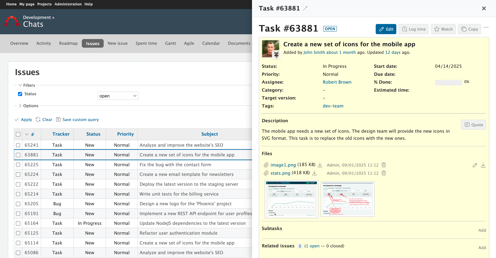
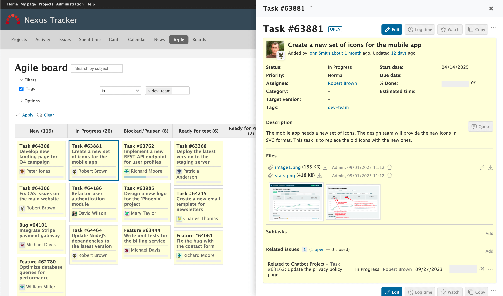

# Redmana - Chrome Extension

Redmine power features inspired by Asana: quick issue drawer, smarter board, and faster daily workflows.

## Features
Redmana brings the most time-saving Redmine enhancements straight into your browser:

- **Instant issue drawer** - open any issue in a lightweight side panel without leaving the board, update tasks inline, and keep the address bar in sync.
- **People overview** - click any user name (board cards, issue lists, inside an issue) to see what they are working on: open issues grouped by status, how long each has sat in its status on them, overdue and high-priority work, and a day-by-day activity feed with status changes, reassignments and comments, plus period stats (issues worked on, commented in, assigned, status changes, time logged). The same overview is added to the top of user profile pages. Requires the Redmine REST API to be enabled (Administration → Settings → API); Redmana uses your own API key, read from your session.
- **Media made easy** - tap thumbnails to view images in a lightbox and stay in context.
- **Agile board superpowers** – upgrade your RedmineUP Agile board with drag-and-drop column reordering, saved layouts, and smooth auto-scrolling while moving cards.
- **Sharper controls** - the assignee list remembers your latest collaborators for faster assignment.

Install the extension, open your Redmine instance, and Redmana activates automatically. No extra configuration steps required.
